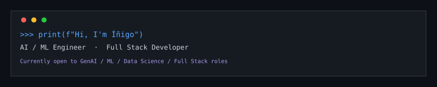
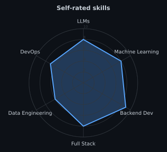
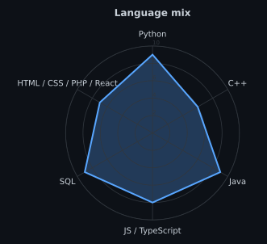
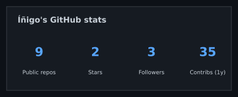
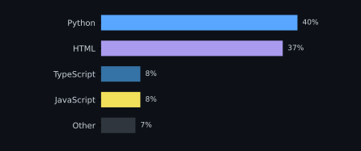

<!-- BANNER - generated by scripts/generate_assets.py from skills.json/langmix.json/stats.json. Edit the data, re-run the script, recommit. -->
<picture>
  <source media="(prefers-color-scheme: dark)" srcset="assets/banner-dark.svg">
  <source media="(prefers-color-scheme: light)" srcset="assets/banner-light.svg">
  
</picture>

 

 

&nbsp;&nbsp;
&nbsp;&nbsp;

  

---

## 🙋 About me

I'm **Íñigo Fernández Barrill**, a software engineer from Pamplona, Spain, specialized in **AI / Machine Learning** and **Full Stack** development.

- 💼 I worked as a **Full Stack Software Developer at [Orisha Commerce](https://www.orisha-commerce.com/) (Openbravo)**, Mutilva (Navarra), from September 2023 to March 2026:
  - Validated a three-agent LLM PoC fine-tuned with LoRA (customer interaction, database queries, RAG over POS docs); the discount and customer-interaction models went into production, with over 80% of interactions returning the expected result.
  - Designed and built REST APIs integrating the Openbravo ERP with external e-commerce platforms, serving 3,500+ POS terminals.
  - Cut production-reported errors in a critical ERP module by ~50% by introducing a unit/integration testing framework.
- 🔬 Before that, I was a **research intern at [Veridas Digital Authentication Solutions](https://veridas.com/)** (Noáin, Navarra), across two periods between 2021 and 2022: improved OCR effectiveness by 12%, cut image-analysis processing time by 85%+ by automating manual processes, and turned 500,000+ files into high-quality training data.
- 🎓 **Master's Degree in Data Science and Machine Learning** — University of La Rioja (2022–2023). My thesis applied Multi-Task Learning to breast cancer detection in mammographies (F1 0.68 with only ~2% positive cases) → [`CancerDetection`](https://github.com/inigo99/CancerDetection).
- 🎓 **Computer Engineering Degree**, specialization in Computing/AI — Public University of Navarre (2017–2022).
- 🌍 Spanish (native) · English (C1) · French (B1).
- 🚀 **Currently looking for opportunities** as a **GenAI, Machine Learning, Data Science or Backend (Python) Engineer**. Available immediately · Pamplona, Spain (CET) · open to remote. If you have something that could be a fit, let's talk!

 

## 🛠️ Stack

**AI / ML:** PyTorch · FastAI · Timm · scikit-learn · Pandas · NumPy
**LLMs / GenAI:** LoRA / QLoRA · Unsloth · vLLM · llama.cpp · Ollama · LangGraph · LangChain · LlamaIndex · RAG · MCP · Hugging Face · MLflow
**Backend / Full Stack:** Python · Java · Node.js · FastAPI · Flask · JavaScript / TypeScript · HTML / CSS · React · Next.js · Expo / React Native
**Data & infrastructure:** PostgreSQL · MySQL · MongoDB · SQLite · DuckDB · LanceDB · Docker · Git · GitHub Actions · Jenkins · Playwright / Scrapling

 

## 📡 Signals

<table>
<tr>
<td width="50%" align="center" valign="middle">

<!-- Self-rated radar - edit skills.json, then run generate_assets.py -->
<picture>
  <source media="(prefers-color-scheme: dark)" srcset="assets/radar-dark.svg">
  <source media="(prefers-color-scheme: light)" srcset="assets/radar-light.svg">
  
</picture>

</td>
<td width="50%" align="center" valign="middle">

<!-- Language mix radar - edit langmix.json, then run generate_assets.py -->
<picture>
  <source media="(prefers-color-scheme: dark)" srcset="assets/radar-langs-dark.svg">
  <source media="(prefers-color-scheme: light)" srcset="assets/radar-langs-light.svg">
  
</picture>

</td>
</tr>
</table>

 

## 📌 Projects

| Project | What it is | Stack |
| --- | --- | --- |
| **[jobradar](https://github.com/inigo99/jobradar)** | Self-hosted job radar: searches job boards, scores every opening against your CV and writes a tailored one-page CV for each one, verified so nothing is invented. Restricted boards (LinkedIn, InfoJobs, Tecnoempleo, Indeed) are opt-in and read through a real browser. 470+ tests and CI; on [PyPI](https://pypi.org/project/jobradar-cv/) as `jobradar-cv`. | Python · FastAPI · SQLite · LLMs (Gemini, Anthropic, OpenAI, Ollama) · MCP · Playwright · Scrapling · Docker · GitHub Actions |
| **[navarra-trip-agent](https://github.com/inigo99/navarra-trip-agent)** | Agent that plans multi-day trips around Navarre from the Government of Navarre's open data: a day-by-day plan with real travel times, a map, lodging and restaurants from the official tourism registry, and the source of every place, or a short list of options ("pintxos bars in Estella"). Evaluated on 93 requests in Spanish, English, French and Basque with code validators and a calibrated LLM judge, comparing five models: a 7B model running locally matches a 120B one (100% real places, 100% constraints met). Ships its own MCP server and a skill. [Live demo](https://navarra-trip-agent.vercel.app) on Vercel's free plan: FastAPI as a serverless function with Groq, multilingual-e5 in ONNX for semantic search, precomputed OSRM travel times and Upstash Redis. | Python · LangGraph · Groq · Ollama (Qwen2.5) · MCP · DuckDB · ONNX Runtime · OSRM · FastAPI · Next.js · TypeScript · MapLibre · Vercel · Redis |
| **[boe-extractor](https://github.com/inigo99/boe-extractor)** | Turns documents from the BOE (Spain's official gazette) into schema-validated JSON with Qwen2.5-1.5B fine-tuned with QLoRA. Quantized to 4 bits, it runs on CPU and performs on par with the paid API model it learned from (F1 0.92 vs 0.91 for Gemini Flash-Lite on hand-annotated documents; base model 0.66, rule-based baseline 0.85), and cuts hallucinations from 12% to about 1%. Evaluated on 262 reviewed documents, tracked in MLflow. A daily GitHub Actions job publishes the day's public-sector jobs, grants and tenders on a [web page](https://inigo99.github.io/boe-extractor/). [Model](https://huggingface.co/inigo99/boe-extractor) and [dataset](https://huggingface.co/datasets/inigo99/boe-extractor-dataset) on Hugging Face. | Python · Unsloth · QLoRA · vLLM · llama.cpp (GGUF) · Pydantic · MLflow · FastAPI · GitHub Actions · Hugging Face |
| **[gym-coach](https://github.com/inigo99/gym-coach)** | Offline mobile app (Android and iOS) to log gym training: routines with schedules and reminders, progress charts, technique cards with a muscle map and level per muscle group. 56 exercises with 179 variants and custom illustrations. GitHub Actions builds the Android APK and publishes it as a release. | TypeScript · Expo · React Native · expo-router · SQLite · Drizzle ORM · Jest · GitHub Actions |
| **[CancerDetection](https://github.com/inigo99/CancerDetection)** | Master's thesis: *Multi-Task Learning for Breast Cancer Detection in Mammographies*. Compares image models (ResNet, EfficientNet, ConvNeXt, HRNet, DeiT), classical tabular models and two Multi-Task Learning architectures on the RSNA Screening Mammography (Kaggle) dataset; best F1 0.68 with only ~2% positive cases, through rebalancing and feature fusion. | PyTorch · FastAI · Timm · scikit-learn |

 

## 📊 Numbers

<!-- Generated by generate_assets.py from stats.json into this repo. Deliberately not the shared
     github-readme-stats/streak-stats public instances: they're rate-limited across everyone using
     them and go down often, taking this section with them. -->
<picture>
  <source media="(prefers-color-scheme: dark)" srcset="assets/card-stats-dark.svg">
  <source media="(prefers-color-scheme: light)" srcset="assets/card-stats-light.svg">
  
</picture>

 

  

Live counts: 

---

Thanks for stopping by 🙂 — <a href="https://www.linkedin.com/in/inigo-fernandez-barrill/">let's connect on LinkedIn</a>

